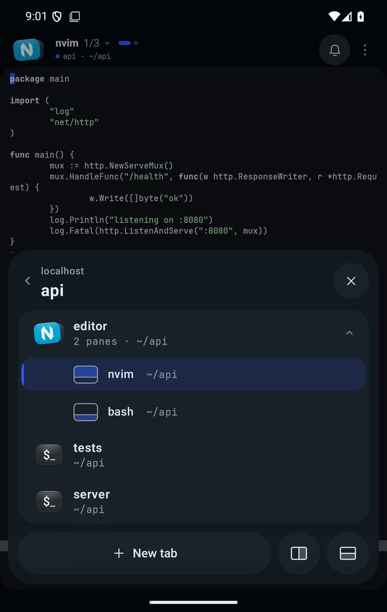
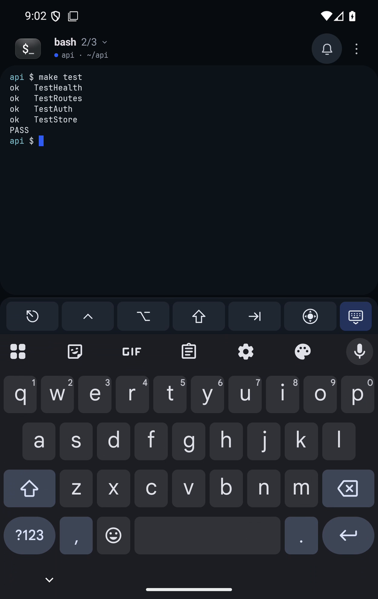
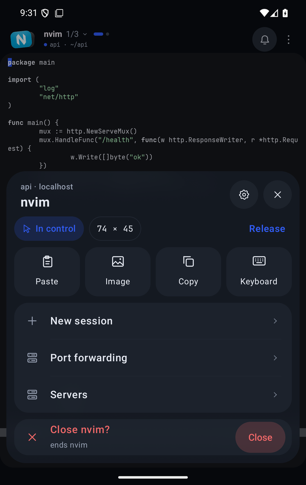
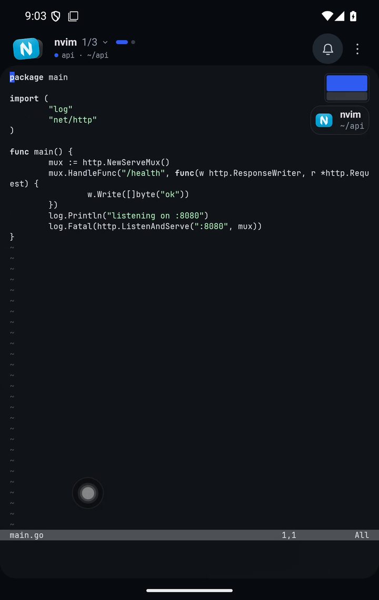
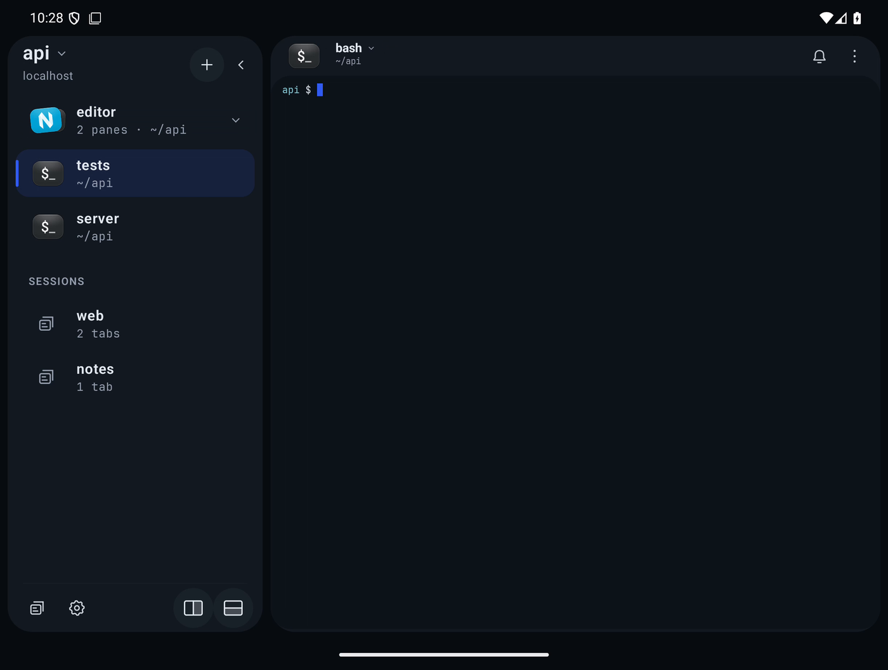
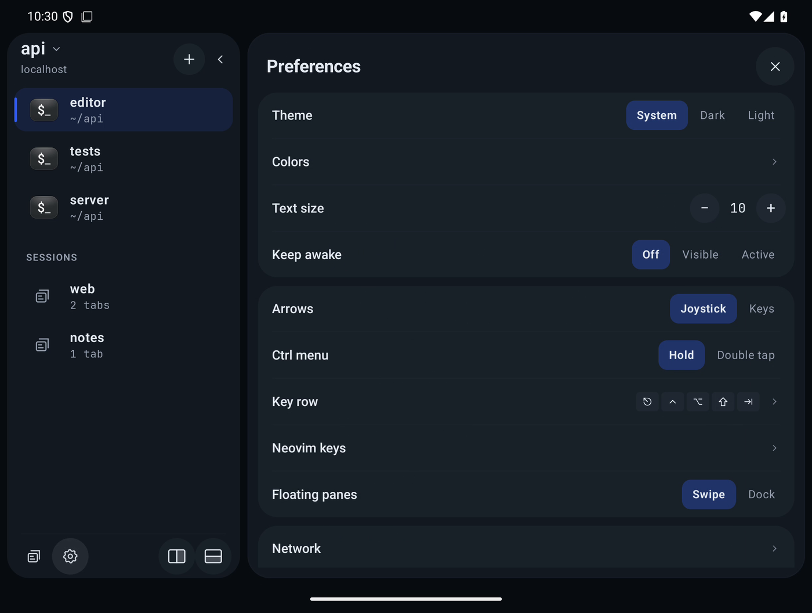

#  Rexling M

Rexling M is a fork of [Rexling](https://github.com/shulhi/rexling) by
[shulhi](https://github.com/shulhi), the unofficial native Android client for
Superlogical Rex. It keeps everything upstream does and reworks the interface
around one-handed phone use and unfolded foldables.

It installs beside upstream's Rexling as a separate app with an orange icon.
[Download the latest APK](https://github.com/mikeyobrien/rexling/releases/latest).

## What's different in this fork

| One switcher | Keys on the keyboard | Close a pane | Pane swipe |
| :---: | :---: | :---: | :---: |
|  |  |  |  |

- **One switcher.** Sessions, tabs and panes live in one card, opened from the
  header. Rename, close and reorder rows in place, or hold the title and slide
  to jump tabs.
- **Keys on the keyboard.** Esc, Ctrl, Alt, Shift, Tab and the arrow joystick
  sit on top of the keyboard and show only while it is open. The keyboard's
  Enter submits.
- **Terminal menu as a card.** Paste, Image, Copy and Keyboard as tiles, then
  the places you can go, then Close pane. An idle shell closes at once; anything
  running is named and asked about first.
- **Pane swipe.** A small layout map in the top right shows where you are,
  clear of the prompt.
- **Preferences on one sheet**, and a first run that asks only for the server
  address.

| Tabs beside the terminal | Sheets dock over the terminal |
| :---: | :---: |
|  |  |

- **Foldables and tablets.** The session's tabs and the other sessions stay in
  a list beside the terminal, which collapses to an icon rail. Sheets open over
  the terminal side, so the list stays in reach.
- **Recovery.** When the session you were viewing ends, the app moves to another
  live session instead of sticking at "Reconnecting".

Measured on an x86_64 emulator at 60 Hz against a local Rex server:

| | Upstream at the fork point | This fork |
| --- | --- | --- |
| Key press to drawn echo, median | 29.1 ms | 13.6 ms |
| Fast-fling frames stuck at the scroll edge | 45% | 0% |
| Frames drawn in 5 idle seconds, wide layout with a working tab | 302 | 11 |

The fork is based on upstream build 157 and does not yet include changes
upstream made after that.

## Overview

Rexling is an unofficial native Android client for Superlogical Rex.
Access your terminal sessions from your phone over Tailscale, with touch controls
for everyday shell work, Neovim, Codex and Claude.

## Installation and build

Rexling supports **Android 9 or newer on 64-bit ARM devices**. You need a running
Rex server. Connect through your phone’s Tailscale VPN, optional built-in Tailscale,
or SSH.

### Install an APK

Download an APK from [this fork's releases](https://github.com/mikeyobrien/rexling/releases)
(or [upstream's](https://github.com/shulhi/rexling/releases) for the original app),
open it on your phone, and allow installation when Android asks. Open Rexling M
and enter your Rex server’s private HTTPS URL or `ssh://user@host`. On Android 17+, allow local
network access when prompted.

### Build from source

Install Android Studio, the Android SDK/NDK, Rust, Go, Python and curl. Exact versions
and setup instructions are in [BUILDING.md](BUILDING.md).

```sh
git clone https://github.com/mikeyobrien/rexling.git
cd rexling
./rexling-android/scripts/gradle.sh :app:shareRelease
```

The build downloads the pinned native dependencies and produces an APK and
SHA-256 checksum in `rexling-android/dist/`. Open `rexling-android/` in Android
Studio to work on the app.

## Features

- **Connection options** — SSH with encrypted key storage or keyless Tailscale SSH,
  optional built-in Tailscale and custom Headscale control servers. See [connection setup](docs/connections.md).

- **Servers and sessions** — connect to multiple Rex servers, create and rename
  sessions, and restore your last session, tab and pane.
- **Tabs and panes** — one switcher for sessions, tabs and panes. Tap to open,
  swipe a row to close, hold it to rename or split, drag it to reorder, and
  dock or float panes. Optional minimized
  floating panes sit in an icon dock.
- **Automatic pane takeover** — opening a pane takes control and resizes its
  terminal to fit your screen, letting terminal applications reflow their text.
- **Kitty graphics** — display terminal images through libghostty, including
  PNG/RGB/RGBA images, transparency and animation. Images restore with the
  terminal snapshot when reconnecting.
- **Touch terminal controls** — arrow joystick, precise navigation popup,
  Ctrl shortcuts, function keys and customizable Neovim shortcuts in a wheel
  or grid.
- **Image uploads** — paste or attach images to supported Rex servers, with
  upload progress and cancellation. Rex inserts the uploaded file’s path into
  the destination terminal. Requires Rex API revision 11 or newer.
- **Port forwarding** — open remote TCP services in your phone’s browser, with
  automatic reconnection and background forwarding. Requires Rex API revision 14
  or newer.
- **Activity and notifications** — track working tasks, finished tasks and
  requests for attention, with optional background alerts.
- **Appearance** — light, dark and system themes, program icons and frosted
  overlays.

See the [Android guide](rexling-android/README.md) for more details.

## Project status and license

Rexling is an independent, unofficial client maintained on a **best-effort basis**.
Compatibility with future Rex versions and ongoing support are not guaranteed.
The app is provided **AS IS**, under the terms of the license.

Copyright 2026 Shulhi Sapli and contributors. Project code is licensed under
[Apache License 2.0](LICENSE). Third-party dependencies and assets retain their
own terms, listed in [THIRD_PARTY_NOTICES.md](THIRD_PARTY_NOTICES.md).
