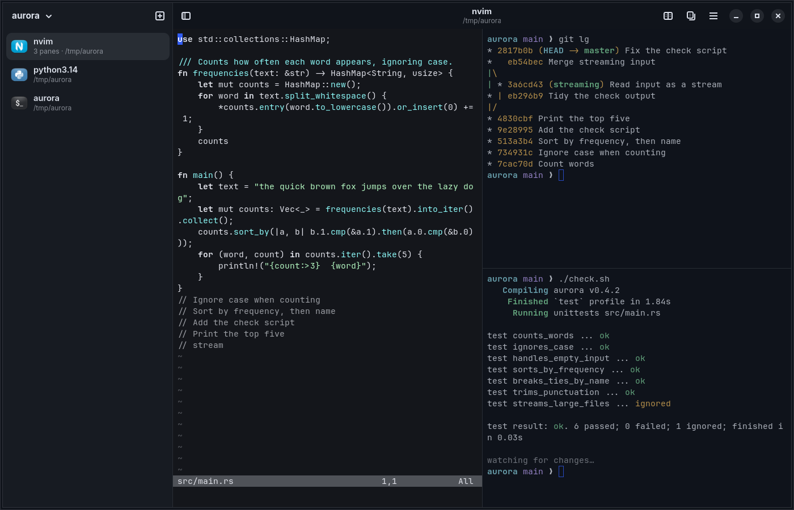
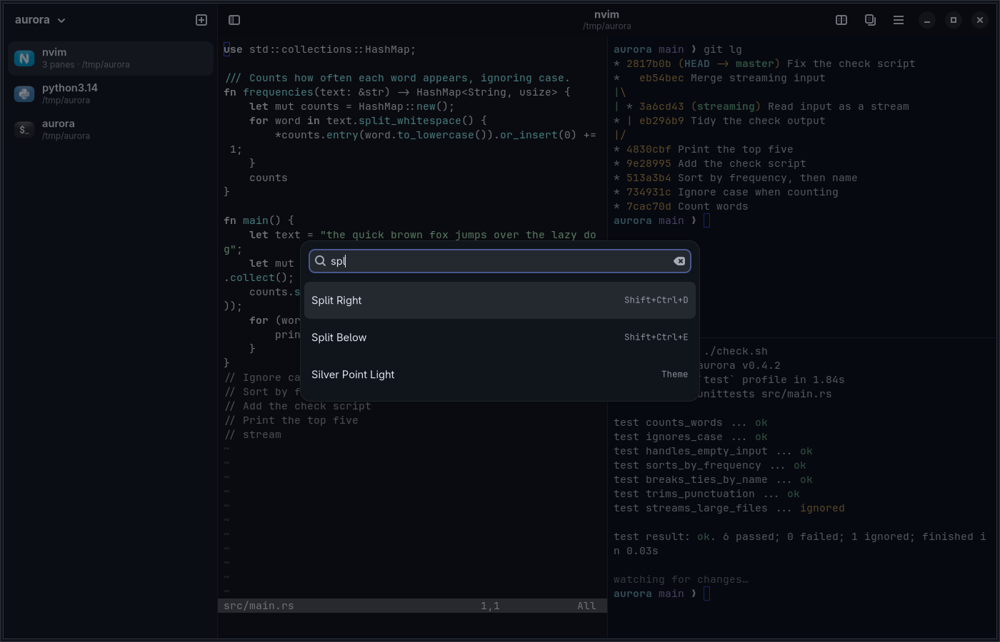
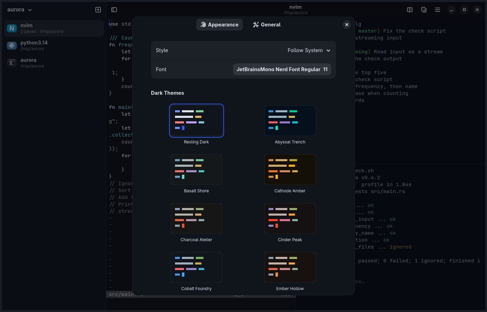
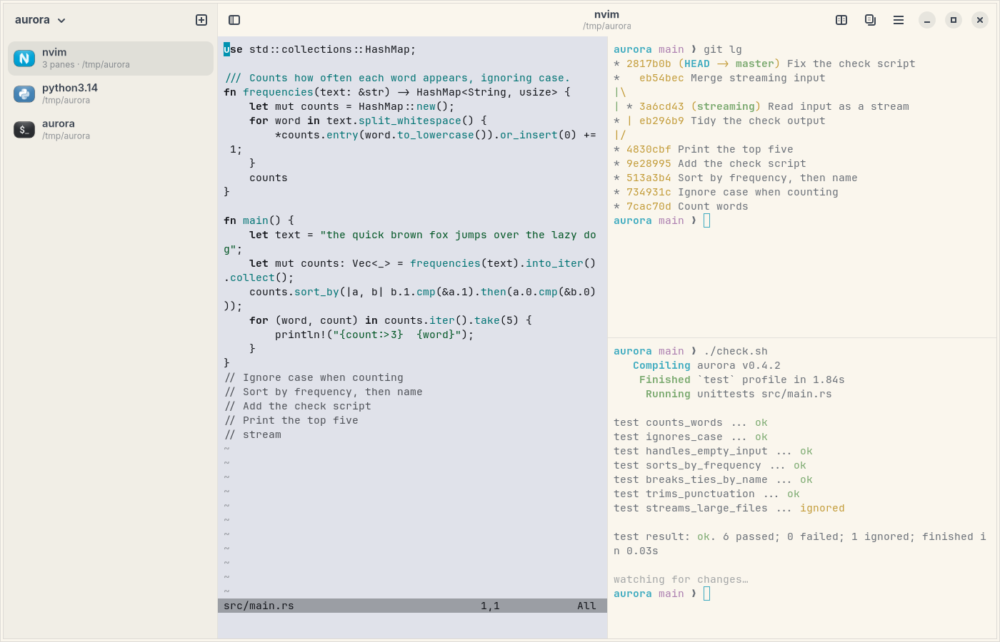

# Rexling for Linux

A native Linux client for [Superlogical Rex](https://superlogical.com): your persistent
terminal sessions, with live split panes, in a GTK 4 / libadwaita window.



Rexling is unofficial. Rex's own desktop app is macOS-only for now; this brings the same
sessions to a Linux desktop, using the Rust engine and libghostty-vt terminal core that the
Rexling Android app already uses.

## What it does

- **Live split panes.** Every pane in a tab is on screen and streaming at once, laid out as
  the server arranges them. Each pane has its own connection, so one busy terminal never
  holds up another. Drag the line between two panes to resize them. Float a pane to lift
  it above the others, then drag it by its bar and resize it by its corner.
- **Nothing to set up on the same machine.** If a Rex server is running under your account,
  Rexling finds its socket and connects. Other servers are reached by HTTPS address, or by
  `ssh://user@host` through your own `ssh`, with your keys, agent and config.
- **Sessions and tabs in a sidebar.** Each tab shows the program it is running, where, and
  whether that program is working, waiting on you, finished or failed. Drag tabs to
  reorder them.
- **Every server in one switcher.** The session switcher lists the sessions of all your
  saved servers, with a dot on any that wants you, and opens whichever you pick.
- **Command palette.** `Ctrl+Shift+P` finds any command, tab, session or theme.
- **43 themes that colour the whole window**, chosen from a gallery, with separate picks
  for light and dark. Your system's light or dark preference is followed by default.
- **A proper terminal.** True colour, bold, italic, underline, wide and combining
  characters, emoji, kitty graphics images, hyperlinks, mouse reporting, an input method
  for composed and CJK text, selection, copy and paste, and scrollback.
- **Desktop notifications** when a program starts waiting on you while you are elsewhere.
- **Images and files.** Paste a copied picture or drop files on a terminal and Rex types
  their path where the cursor is.
- **Port forwards** that make a port on the server reachable on your computer (Rex API
  revision 14 or newer).
- **It only watches until you act.** Opening Rexling never takes a terminal away from
  another device. Your first click or keypress takes control, and nothing you type in that
  moment is lost.

| | |
| --- | --- |
|  |  |



## Install

You need Rust 1.93+, GTK 4.14+, libadwaita 1.6+, Python 3 and a C compiler.

```sh
git clone https://github.com/shulhi/rexling.git
cd rexling
python3 rexling-core/scripts/build_native.py --host-build   # once: builds libghostty-vt
./rexling-gtk/install.sh
```

On Arch Linux and Omarchy, build a package instead:
`cd rexling-gtk/packaging/arch && makepkg -si`.

`install.sh` puts `rexling`, a launcher entry and an icon under `~/.local`.
`./rexling-gtk/install.sh --uninstall` removes them. To run from the source tree instead:
`cargo run --release --manifest-path rexling-gtk/Cargo.toml`.

On first launch Rexling connects to the Rex server on this computer, if there is one.
Otherwise it asks for an address:

| Address | Reaches |
| --- | --- |
| `https://myhost.example.ts.net:7297` | A Rex server served over your tailnet or network |
| `ssh://user@host` | The Rex server of that account, through your own `ssh` |
| `unix:///path/to/server.sock` | A Rex server socket on this computer |

`ssh://` needs key or agent sign-in that works without a prompt, and a host you have
connected to before. Saved servers are listed in Preferences, the command palette and the
session switcher. Sessions on `ssh://` servers appear once that server is opened.

## Keys

| Keys | Action |
| --- | --- |
| `Ctrl+Shift+P` | Command palette |
| `Ctrl+Shift+T` | New tab |
| `Ctrl+Shift+N` | New window, for a second session or server side by side |
| `Ctrl+Shift+D` / `Ctrl+Shift+E` | Split right / below |
| `Ctrl+Shift+W` | Close pane |
| `Ctrl+Shift+Enter` | Zoom the focused pane |
| `Ctrl+Alt+Left` / `Ctrl+Alt+Right` | Previous / next pane |
| `Ctrl+PageUp` / `Ctrl+PageDown` | Previous / next tab |
| `Ctrl+Shift+PageUp` / `Ctrl+Shift+PageDown` | Move the tab up / down |
| `F2` | Rename the tab |
| `Ctrl+Shift+S` | Switch session |
| `Ctrl+Shift+B` | Show or hide the sidebar |
| `Ctrl+Shift+C` / `Ctrl+Shift+V` | Copy / paste |
| `Shift+PageUp` / `Shift+PageDown` | Scroll back |
| `Ctrl++` / `Ctrl+-` / `Ctrl+0` | Text size |
| `Ctrl+,` | Preferences |

Drag to select, double-click to select a word, middle-click to paste the selection, and
click a link to open it. Right-click a tab to rename, move or close it. Everything else,
including sessions, images and port forwards, is in the command palette.

## Settings

Preferences cover the style, font, themes, server and notifications. They are stored in
`~/.config/rexling/gtk.json`.

## Performance

Measured on the release build with software rendering (no GPU), a 132×42 terminal
repainting continuously:

| | |
| --- | --- |
| Window on screen after launch | about 0.1 s |
| Full terminal repaint | about 1.1 ms on average |

Set `REXLING_TIMING=1` to print repaint times while you work.

## Not built yet

- A built-in Tailscale client. Use the system's Tailscale; the Android app carries its own
- Packages beyond Arch. Other distributions build from source with `install.sh`

## How it is put together

| Path | Purpose |
| --- | --- |
| `src/client.rs` | One connection to the server and the rules for control and sizing |
| `src/window.rs` | The window: sidebar, pane layout, status, notifications |
| `src/terminal.rs` | The terminal view: drawing, keyboard, pointer and input method |
| `src/panegrid.rs` | Places panes by the fractions the server gives them |
| `src/dialogs.rs` | Command palette, preferences, shortcuts, About |
| `src/theme.rs`, `src/palette.rs` | Themes and the window stylesheet generated from them |
| `src/tunnel.rs` | `ssh://` servers and finding the local Rex socket |
| `src/tiles.rs`, `src/programs.rs` | Program artwork and which program gets which |

Themes and program artwork are shared with the Android app and read from its assets at
build time. `cargo test` runs the unit tests; `cargo clippy` is kept clean.

Rexling is licensed under Apache 2.0. Third-party notices are in
[THIRD_PARTY_NOTICES.md](../THIRD_PARTY_NOTICES.md).
